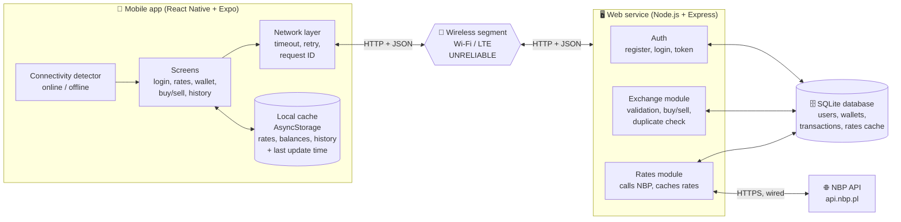
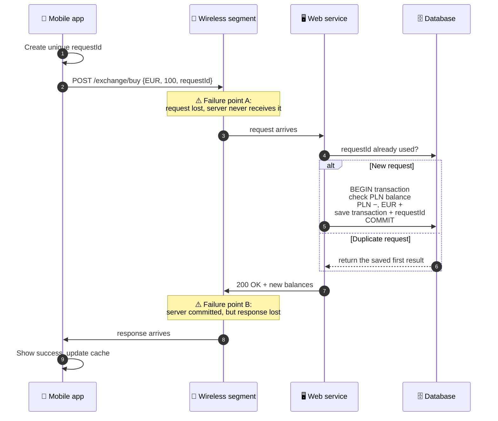

# Architecture Sketch (Lab 01)

Initial end-to-end architecture of the Mobile Currency Exchange System.
This is a first sketch. It will be refined into the full architecture and data-flow
diagram for the M1 report.

## 1. Components

| Component | Role |
|---|---|
| Mobile app | User interface. Shows data, sends requests, keeps a read-only local cache. Never decides the result of a buy/sell. |
| Wireless segment | Phone ⇄ access point / base station. The unreliable part: loss, delay, timeouts, disconnections. |
| Web service | Business logic: authorisation, validation, exchange operations, NBP integration, duplicate-request protection. |
| Database | Permanent storage. The authoritative record of users, wallet balances and transactions. |
| NBP API | External source of current and historical exchange rates. |

## 2. Request path: "Buy 100 EUR"

**Why it matters:** after a timeout the app can't tell failure point A from failure point B.
The app therefore retries with the **same requestId**. In case A the server performs
the operation for the first time. In case B the server recognises the ID and returns the
earlier result, so the money is not exchanged twice.

## 3. Data owners

| Data | Authoritative owner | Copies | Notes |
|---|---|---|---|
| User accounts, password hashes | Web service DB | – | Passwords stored only as hashes |
| Wallet balances | Web service DB | Phone cache (read-only, with timestamp) | Phone never edits balances itself |
| Transactions | Web service DB | Phone cache (history, read-only) | Each one stores its requestId (UNIQUE) |
| Exchange rates | NBP | Server rates cache → phone cache | Shown with "rate from" date and time |
| Auth token | Web service (issues it) | Phone secure storage | Sent with every request |
| requestId of a pending operation | Phone (creates it) | Server stores it with the transaction | Lets the server detect repeats |
