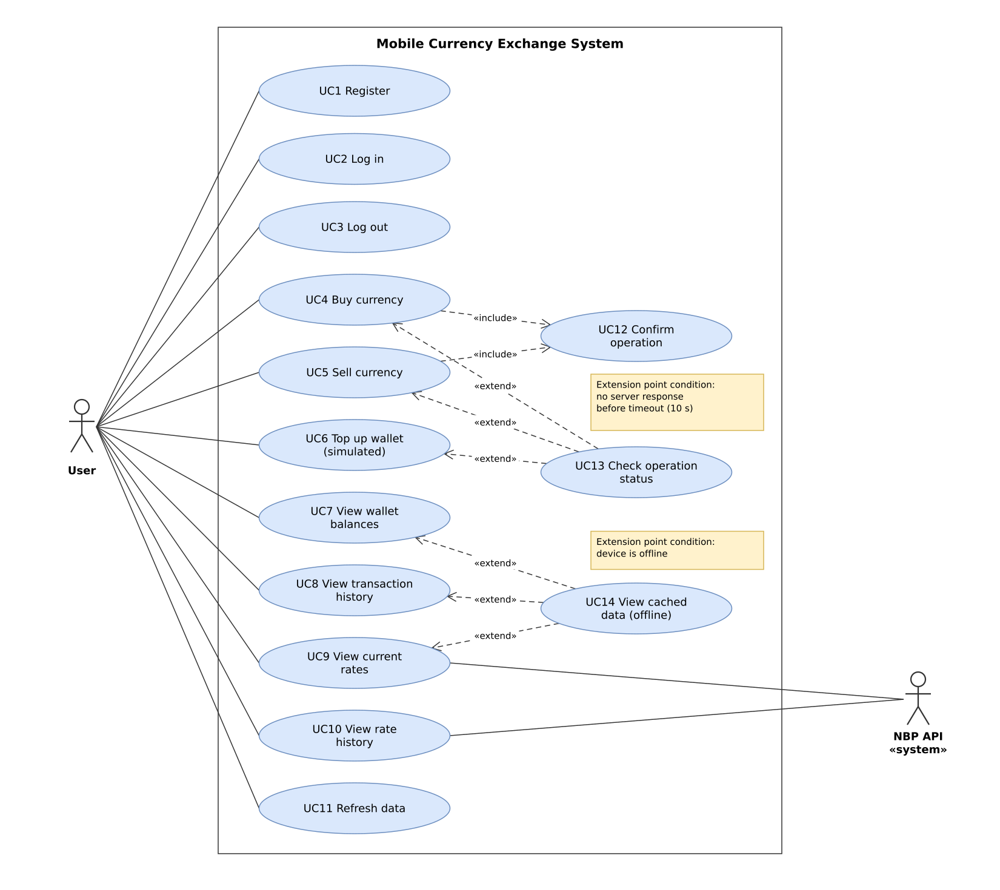

# 4. UML Diagrams

## 4.1. Use Case Diagram

Editable source: `docs/diagrams/use-case-diagram.drawio`

### Actors

| Actor | Type | Description |
|---|---|---|
| User | Primary | A person using the mobile app. Before logging in they can only register or log in. |
| NBP API | Secondary (external system) | National Bank of Poland web API; provides current and historical exchange rates. |

### Use cases

| ID | Use case | Short description | Requirements |
|---|---|---|---|
| UC1 | Register | User creates an account with email and password. | F1 |
| UC2 | Log in | User logs in and receives an access token. | F2 |
| UC3 | Log out | User logs out; token and cached personal data are removed. | F3 |
| UC4 | Buy currency | User buys a currency with PLN. Includes UC12. | F7 |
| UC5 | Sell currency | User sells a currency for PLN. Includes UC12. | F8 |
| UC6 | Top up wallet (simulated) | User adds virtual PLN to the wallet. | F4 |
| UC7 | View wallet balances | User sees the balance of each currency. | F10 |
| UC8 | View transaction history | User sees a list of past operations. | F11 |
| UC9 | View current rates | User sees current NBP rates with table date and fetch time. | F5, F12 |
| UC10 | View rate history | User sees a chart of a currency's rate for 7/30/90 days. | F6 |
| UC11 | Refresh data | User manually refreshes data (pull-to-refresh). | F18 |
| UC12 | Confirm operation | App shows amount, rate and total; user confirms before sending. | F9, N8 |
| UC13 | Check operation status | When a buy, sell or top-up gets no response before the timeout, the app shows "Checking status…" and resends the request with the same request ID. | F16, F17, N4, N5 |
| UC14 | View cached data (offline) | When the device is offline, balances, history and rates are shown from the local cache with their "last updated" time. | F13, F14, F15, N10 |

### Relationships

- **«include»** (UC4, UC5 → UC12): confirmation is always part of buying and selling.
- **«extend»** (UC13 → UC4, UC5, UC6): status checking happens only under a condition:
  no server response before the timeout.
- **«extend»** (UC14 → UC7, UC8, UC9): the offline view happens only under a condition:
  the device is offline.
